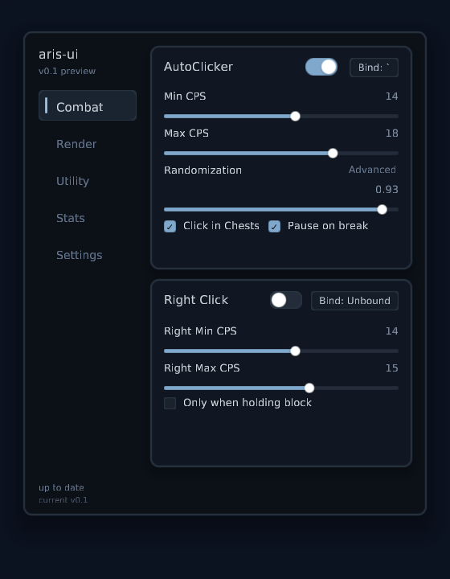
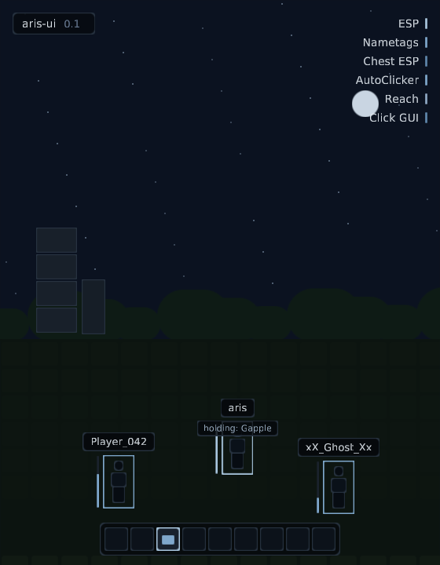
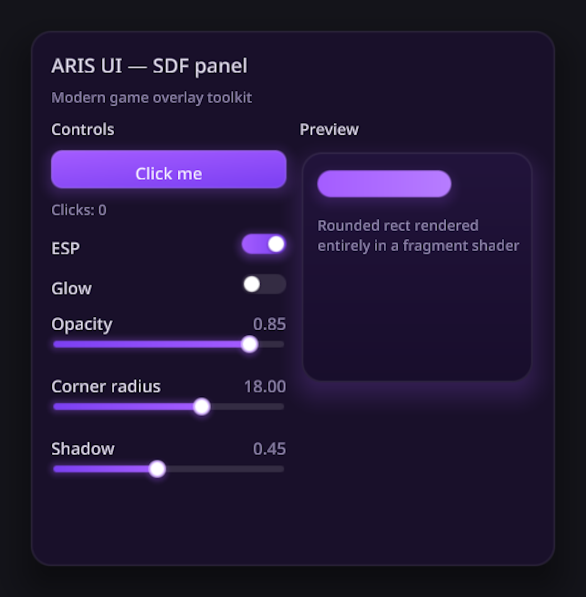
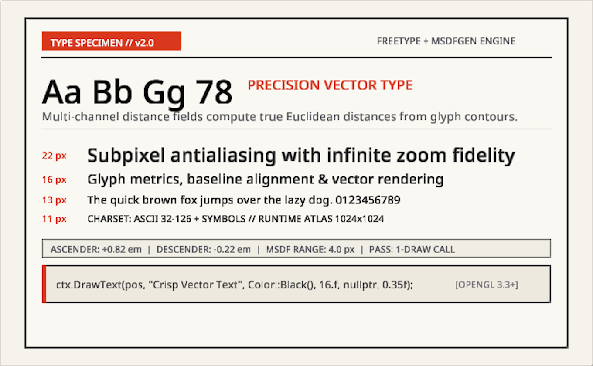

# aris-ui

[English](README.md) | **简体中文**

**更好看的 ImGui 替代品。为 Agent 优化。**

一个轻量、现代的 C++20 即时模式 UI 库，面向 OpenGL 覆盖层注入场景 —— Minecraft（1.8.9 到最新版本）以及任何基于 OpenGL 的应用。控件以解析式抗锯齿的有符号距离场（SDF）渲染，文本来自离线生成的 MSDF 图集，面板布局使用 Yoga flexbox，并且离开时宿主的 OpenGL 状态与进入时完全一致。没有网页引擎，没有资源占用，也没有敷衍的默认值。

## 预览

<p align="center">
  
  
  
  
</p>

上面的每张图都是 `make preview` 无头渲染出的真实帧缓冲截图（共 15 个场景）；完整图库见[文档首页](docs/index.html)。

## 设计原则

1. **是库，不是框架。** 执行由调用方驱动：进程生命周期、事件循环与交换链始终归宿主所有。你可以按自己的需要在任意位置调用 `ProcessInput()`、`BeginFrame()` 和 `Render()`。
2. **解耦的三层设计。**
   - *核心引擎* —— 100% 平台无关的 C++20（数学、布局树、动画、控件状态、绘制命令生成）。
   - *渲染后端* —— 纯 OpenGL Core Profile 3.2+（SDF 着色器、动态批处理、防御式状态守卫），不依赖宿主的图形管线。
   - *平台 / 输入层* —— 独立输入适配器（Win32 `WndProc`、GLFW 回调），把通用输入事件送入核心。
3. **快速的独立开发循环。** 自带 GLFW + OpenGL 桌面运行器，无需运行游戏或调试注入即可快速原型验证。

## 快速开始

```bash
git clone <repo> aris-ui && cd aris-ui
make configure        # 等价于 cmake -S . -B build -DARIS_UI_BUILD_TESTS=ON
make build            # 等价于 cmake --build build
make test             # 单元测试（ctest）
make preview          # 无头 UI 截图 → previews/*.png
make demo             # 可交互的桌面运行器窗口
```

运行器会渲染标准演示界面：圆角 SDF 面板、动画按钮、开关与滑块、MSDF 文本。若想在不打开窗口的情况下获得每个控件的像素级预览，`make preview` 会直接写出 PNG 截图。

## 最小用法（宿主集成）

```cpp
ui::Context ctx;
ui::FontAtlas font;
font.Load("atlas.png", "atlas.json");   // 由 tools/atlas_generator 离线生成
ctx.SetFont(&font);

// 每帧，在持有 GL 上下文的那条线程上调用：
ctx.BeginFrame(dt, width, height, uiScale);
for (const auto& e : hostEvents)
    if (ctx.ProcessInput(e)) { /* 拦截输入，阻止其传给游戏 */ }

if (ctx.BeginPanel("main", {16, 16, 380, 520}, ui::PanelStyle{})) {
    if (ui::Button(ctx, "Click me")) ++clicks;
    ui::Toggle(ctx, "Enable", &enabled);
    ui::Slider(ctx, "Opacity", &opacity, 0.f, 1.f);
}
ctx.EndPanel();

ctx.Render();   // 通过 GL 后端冲刷绘制命令
```

## 写给 Agent（以及习惯像 Agent 一样思考的人）

- **[AGENTS.md](AGENTS.md)** —— 仓库导览、验证流程与已知坑点。
- **`make preview`** —— 确定性的无头截图（`examples/scene_preview`，15 个具名场景，含模拟悬停/按下输入）→ `previews/*.png`。渲染之后要*亲眼看*这些 PNG。
- **`make test`** —— 基于 ctest 的 38 个单元测试，不使用第三方测试框架。
- **`docs/llms.txt`** 与 **`docs/llms-full.txt`** —— 面向 Agent 的文档索引；每个文档页在 `docs-src/` 中都有对应的 Markdown 源文件。

## 文档

完整文档位于 [`docs/`](docs/index.html)（可直接用于 GitHub Pages），Markdown 源码在 [`docs-src/`](docs-src/)：入门、核心概念、控件、布局、渲染、字体与 Agent 工具。

## 仓库结构

```
├── include/ui/           # 公共头文件（core、layout、renderer、font、widgets）
├── src/                  # 实现
├── tools/atlas_generator # 离线 MSDF 图集生成器（FreeType + msdfgen）
├── examples/
│   ├── desktop_runner/   # 独立 GLFW 测试台
│   └── minecraft_hook/   # 最小注入 DLL 示例（后续阶段）
├── assets/               # 字体与生成的图集
└── third_party/          # 固定版本：yoga、glad、stb、msdfgen、nlohmann/json
```

分阶段的路线图与当前进度见 [PROGRESS.md](PROGRESS.md)。

## 许可证

MIT —— 详见 [LICENSE](LICENSE)。内嵌的第三方库保留各自的许可证（见 `third_party/`）。
